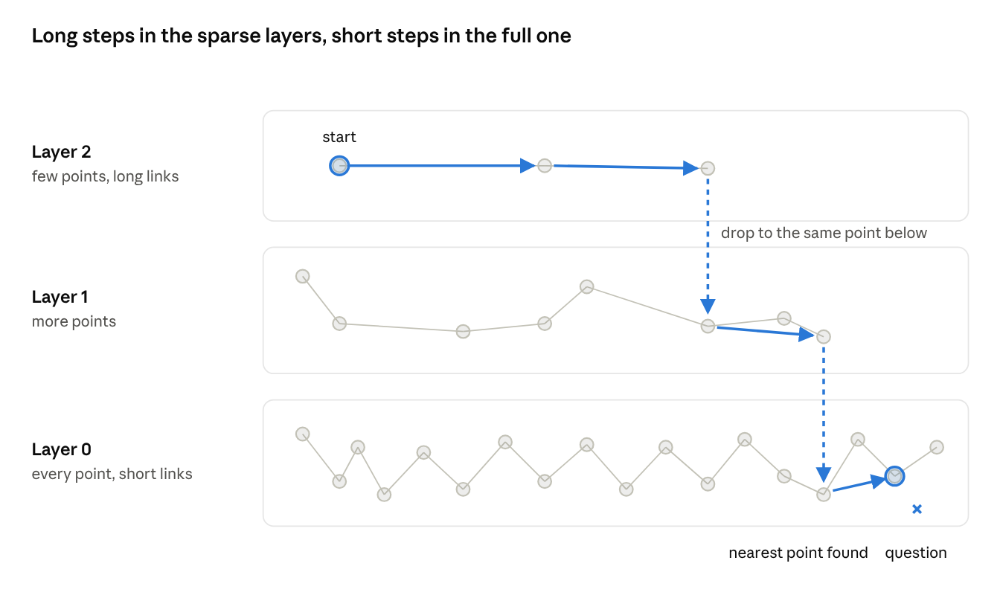

# Chapter 7 — Vector databases

## 7.1 What this chapter builds

Chapter 4 compared a question with every passage. That is **exact search**: always right, and the work grows with the number of passages. A **vector database** stores embeddings with their text and facts about each one, and finds the closest without comparing every one.

1. **Exact search and what it costs** (7.2): time per search on 1,000 to 100,000 embeddings.
2. **Near-neighbour graphs** (7.3): two graphs built by hand and searched the way vector databases search; one fails, one finds almost every true neighbour for a few per cent of the work.
3. **HNSW** (7.4): how the method most vector databases use adds layers to that graph, and the settings it exposes.
4. **Storing the corpus in Chroma** (7.5): the 56 passages, their embeddings and their source, edition, scope and licence in one database on disk.
5. **A check** (7.6): Chroma ranks passages as Chapter 4 did, on all 32 definition questions.
6. **Chapter 6's chunks** (7.7): McCarthy's chapter, cut into chunks, embedded and searched.

At this book's size, exact search is fast enough; 7.2 shows it. The database earns its place by keeping text, embeddings and facts together on disk, and by filtering on those facts before searching (Chapter 8).

**Code file:** `ragbook/ch07_vector_store.py`

**Uses:** chromadb 1.5.9, an open-source vector database (Apache 2.0) that runs inside Python, with no server (added to `requirements.txt`); numpy; Python's `time` module. From earlier chapters: `load_corpus` (Chapter 2), `load_questions` (Chapter 3), `cosine_similarities`, `SemanticIndex` and `load_embeddings` (Chapter 4), `saved_question_embedder` (Chapter 5); in 7.7, `load_model`, `embed_texts` and the chunking functions of Chapter 6.

## 7.2 Exact search and what it costs

### 7.2.1 Principles

Exact search compares the question with every stored embedding. With 384 numbers per embedding, each comparison is 384 multiplications and additions, so ten times as many embeddings take about ten times as long.

To measure that without a model, the code makes test embeddings. Random numbers scattered evenly would be unlike real ones: embeddings of texts on one subject point in similar directions. So each test embedding is one of 50 **group centres** plus some noise, scaled to length 1. Test questions are drawn the same way, from the same groups, as real questions share subjects with the corpus.

### 7.2.2 Code

`ragbook/ch07_vector_store.py`, the functions `random_embeddings`, `exact_search` and `time_exact_search`

```python
def random_embeddings(how_many, dimensions=384, groups=50, spread=0.6, seed=42):
    """
    Make embeddings for testing: rows of numbers of length 1, in groups.

    Real embeddings are not scattered evenly: texts on one subject point in
    similar directions. So each row here is one of `groups` group centres
    plus some noise (`spread`), then scaled to length 1. The same `seed`
    always gives the same rows.

    Example:
        random_embeddings(1000).shape
        returns (1000, 384)
    """
    generator = np.random.default_rng(seed)
    centres = generator.normal(size=(groups, dimensions))
    centres = centres / np.linalg.norm(centres, axis=1, keepdims=True)
    group_of_row = generator.integers(0, groups, size=how_many)
    noise = generator.normal(scale=spread / np.sqrt(dimensions), size=(how_many, dimensions))
    rows = centres[group_of_row] + noise
    return (rows / np.linalg.norm(rows, axis=1, keepdims=True)).astype(np.float32)
```

```python
def exact_search(vectors, query, how_many=10):
    """
    Return the rows of `vectors` most similar to `query`, most similar first.

    Every row is compared with the query (Chapter 4's cosine_similarities),
    so the answer is always right, and the work grows with the number of
    rows.

    Example:
        exact_search(np.array([[1, 0], [0, 1], [0.8, 0.6]]), np.array([1, 0]), 2)
        returns [0, 2]
    """
    similarities = cosine_similarities(vectors, query)
    order = np.argsort(-similarities, kind="stable")
    return [int(row) for row in order[:how_many]]
```

```python
def time_exact_search(sizes, dimensions=384, queries=20):
    """
    Measure the average time of one exact search, in milliseconds, for each
    number of embeddings in `sizes`.

    Returns a list of (number of embeddings, milliseconds per search).
    Times depend on the computer; what matters is how they grow.

    Example:
        time_exact_search([1000, 10000])
        returns two pairs, the second about ten times slower
    """
    results = []
    for size in sizes:
        vectors = random_embeddings(size, dimensions)
        questions = random_embeddings(size + queries, dimensions)[size:]
        start = time.perf_counter()
        for query in questions:
            exact_search(vectors, query)
        seconds = time.perf_counter() - start
        results.append((size, 1000 * seconds / queries))
    return results
```

### 7.2.3 Annotations

- `np.random.default_rng(seed)` makes a random number generator that gives the same numbers every time for the same seed, so every run and test sees the same embeddings.
- `generator.normal(size=(groups, dimensions))` draws a table of random numbers; dividing each row by its length (`np.linalg.norm`) makes it length 1. `centres[group_of_row]` picks each row's centre.
- `spread / np.sqrt(dimensions)` sets the noise so that its total size is about `spread` whatever the number of dimensions.
- `random_embeddings(size + queries)[size:]` makes the questions as extra rows of the same table: same groups, not seen in the stored rows.
- `np.argsort(-similarities, kind="stable")` lists the rows from most to least similar; `kind="stable"` keeps equal scores in row order, as in Chapter 4.
- `time.perf_counter()` reads a clock to fractions of a microsecond; the difference between two readings is the time taken.

On the author's laptop (`python -m ragbook.ch07_vector_store`), 20 searches at each size:

| Embeddings | Milliseconds per search |
| --- | --- |
| 1,000 | 2.8 |
| 10,000 | 31.2 |
| 100,000 | 316.7 |

Ten times the embeddings take about ten times as long. The seven manuals of Chapter 6 give about 35,000 recursive chunks, so an exact search over all of them takes about a tenth of a second on this laptop: fast enough for one person asking questions. At millions of embeddings, or many people searching at once, it would not be.

## 7.3 Near-neighbour graphs, searched by hand

### 7.3.1 Principles

A vector database avoids comparing every embedding by storing a **graph**: each embedding is a point, linked to some of the points close to it. A search starts at one point and moves along links towards the question, comparing the question only with the points it passes.

The search keeps a list of the best points found so far. Each step takes the closest point not yet explored and compares the question with that point's links. A linked point closer than the worst on the list joins it. When no unexplored point on the list can improve it, the search stops. A longer list finds more of the true nearest points and makes more comparisons; HNSW calls its length **ef**.

The result is an **approximate** answer. It is measured by **recall**: the share of the true ten nearest points, found by exact search, that the graph search also finds.

Which links to store decides whether the search works. Two graphs are compared, each with 16 links per point:

- **Nearest neighbours only.** Each point links to its 16 closest points. When points form groups, every link stays inside its group: the graph is a set of islands, and a search that starts in one never reaches another.
- **Built as points arrive.** Each new point links to its 16 closest points among those already added, and they link back. The first points arrive when there are few others, so their closest points are often in other groups: their links cross between groups. Later points add short links inside groups. This is a **navigable small world (NSW)**: a few steps cross the collection, and the search ends among close neighbours.

### 7.3.2 Code

`ragbook/ch07_vector_store.py`, the functions `nearest_neighbour_graph`, `navigable_graph`, `graph_search`, `recall` and `measure_graph_search`

```python
def nearest_neighbour_graph(vectors, neighbours=16):
    """
    Link each row to the `neighbours` other rows most similar to it.

    This looks like the right graph for a near-neighbour search, but when
    the rows form groups, every link stays inside its group: the graph
    falls apart into islands, and a search that starts in one island never
    reaches another (7.3).

    Example:
        nearest_neighbour_graph(vectors)[0]
        returns the 16 rows closest to row 0
    """
    graph = []
    for row in range(len(vectors)):
        similarities = vectors @ vectors[row]
        similarities[row] = -np.inf          # a row is not its own neighbour
        order = np.argsort(-similarities, kind="stable")
        graph.append([int(other) for other in order[:neighbours]])
    return graph
```

```python
def navigable_graph(vectors, neighbours=16):
    """
    Build the graph as rows arrive: each new row links to the `neighbours`
    most similar rows already in the graph, and they link back.

    The first rows arrive when the graph is small, so their nearest rows
    are often in other groups: their links cross between groups. Later
    rows add short links inside groups. A search can then cross the
    collection in a few steps and finish among close neighbours. This is
    a navigable small world (NSW), the graph inside HNSW (7.4).

    Example:
        navigable_graph(vectors)[0]
        returns the rows linked to row 0, the first row added
    """
    graph = [[] for _ in range(len(vectors))]
    for row in range(1, len(vectors)):
        similarities = vectors[:row] @ vectors[row]
        for other in np.argsort(-similarities, kind="stable")[:neighbours]:
            graph[row].append(int(other))
            graph[int(other)].append(row)
    return graph
```

```python
def graph_search(graph, vectors, query, how_many=10, candidates=50, start=0):
    """
    Find rows close to `query` by walking the graph from row `start`.

    The search keeps a list of the best rows found so far, at most
    `candidates` long. Each step takes the closest row not yet explored
    and compares the query with that row's neighbours; a neighbour closer
    than the worst on the list joins it. The search stops when no
    unexplored row on the list could improve it.

    A longer list (`candidates`) finds more of the true nearest rows and
    makes more comparisons. HNSW calls this length ef.

    Returns the `how_many` best rows found, closest first, and the number
    of comparisons made.

    Example:
        rows, comparisons = graph_search(graph, vectors, query)
        rows has 10 entries; comparisons is far fewer than len(vectors)
    """
    def similarity(row):
        return float(vectors[row] @ query)

    visited = {start}
    comparisons = 1
    best = [(similarity(start), start)]      # (similarity, row), at most `candidates` long
    to_explore = list(best)
    while to_explore:
        closest = max(to_explore)
        to_explore.remove(closest)
        if len(best) == candidates and closest[0] < min(best)[0]:
            break                            # nothing left on the list can help
        for neighbour in graph[closest[1]]:
            if neighbour in visited:
                continue
            visited.add(neighbour)
            comparisons += 1
            found = (similarity(neighbour), neighbour)
            if len(best) < candidates or found > min(best):
                best.append(found)
                to_explore.append(found)
                if len(best) > candidates:
                    best.remove(min(best))
    best.sort(reverse=True)
    return [row for _, row in best[:how_many]], comparisons
```

```python
def recall(found, true):
    """
    The share of the true nearest rows that a search found, from 0 to 1.

    Example:
        recall([1, 2, 9], [1, 2, 3])
        returns 0.667 (two of three)
    """
    return len(set(found) & set(true)) / len(true)
```

```python
def measure_graph_search(graph, vectors, queries, candidate_lengths=(10, 20, 50, 100), how_many=10):
    """
    For each list length, search the graph with every query and compare
    the result with exact search.

    Returns one row per length: (length, average recall, average
    comparisons).

    Example:
        measure_graph_search(graph, vectors, queries)[0]
        returns (10, recall at list length 10, comparisons at that length)
    """
    true_answers = [exact_search(vectors, query, how_many) for query in queries]
    results = []
    for length in candidate_lengths:
        recalls = []
        comparisons = []
        for query, true in zip(queries, true_answers):
            found, made = graph_search(graph, vectors, query, how_many, length)
            recalls.append(recall(found, true))
            comparisons.append(made)
        results.append((length, float(np.mean(recalls)), float(np.mean(comparisons))))
    return results
```

### 7.3.3 Annotations

- The test embeddings have length 1, so `vectors @ vectors[row]` gives every row's cosine similarity with one row in a single step.
- `similarities[row] = -np.inf` sets a row's similarity with itself to minus infinity, so it is never its own neighbour.
- In `navigable_graph`, `vectors[:row]` holds only the rows added before this one; that is what makes the early links long.
- `graph_search` keeps pairs (similarity, row). `max` and `min` compare pairs by their first number, so `max(to_explore)` is the closest unexplored row and `min(best)` the worst row on the list.
- `visited` is a **set**: a collection that answers "is this row in it?" at once. It stops the search comparing a row twice.
- `set(found) & set(true)` keeps the rows in both sets.

On 5,000 test embeddings, with 100 test questions and the ten true nearest rows as the target:

| Graph | List length (ef) | Recall | Comparisons per search |
| --- | --- | --- | --- |
| Nearest neighbours only | 10 | 0.009 | 69 |
| Nearest neighbours only | 100 | 0.010 | 100 |
| Built as points arrive | 10 | 0.988 | 278 |
| Built as points arrive | 20 | 0.990 | 287 |
| Built as points arrive | 50 | 1.000 | 308 |
| Built as points arrive | 100 | 1.000 | 392 |

The graph of nearest neighbours only finds almost nothing: the search stays on the island where it starts. The graph built as points arrive finds 99% of the true neighbours with 278 comparisons, against 5,000 for exact search: about 6% of the work. The author's laptop gives the same figures, because the seed fixes the test embeddings.

A first version of this test drew its questions from different groups than the stored embeddings. Recall was then poor for every graph, because a question far from every group has no clear nearest neighbours. Real questions share subjects with the corpus, so the questions here come from the same groups.

## 7.4 HNSW: layers and settings

**HNSW** (hierarchical navigable small world) is the method behind most vector databases, Chroma included. Malkov and Yashunin published it in 2016 (7.8.3). It builds the graph of 7.3 as points arrive, and adds **layers**:

- Every point is in the bottom layer, layer 0. Each new point is also given a random top layer: with 16 links per point, about one point in 16 reaches layer 1, one in 256 layer 2, and so on.
- An upper layer holds few points, so its links are long. A search starts at a fixed entry point in the top layer and moves towards the question there, then drops to the same point one layer down and moves again. In layer 0 it runs the search of 7.3, with a list of length ef.



The upper layers bring the search close to the answer in a few long steps, so the search in layer 0 starts near it. The paper reports that the number of steps then grows with the logarithm of the number of points, not with the number itself. That matters at millions of points; the 5,000 points of 7.3 need no layers.

Chroma exposes these choices as settings:

| Setting | Chroma's name | Default | What a larger value does |
| --- | --- | --- | --- |
| Links per point | `max_neighbors` | 16 | Higher recall; more memory; slower to add points |
| List length when adding a point | `ef_construction` | 100 | Better links; slower to add points |
| List length when searching | `ef_search` | 100 | Higher recall; more comparisons per search (7.3) |
| Similarity | `space` | squared distance (`l2`) | Set to cosine in 7.5, as in Chapter 4 |

The defaults are Chroma's own, read from a new collection's configuration. This book keeps them.

## 7.5 Storing the corpus in Chroma

### 7.5.1 Principles

**Chroma** is an open-source vector database (Apache 2.0). It runs inside the Python program, keeps its data in a folder, and needs no server and no internet. A database's searchable set of embeddings is a **collection**. Each item in a collection has four parts:

| Part | Chroma's name | Here |
| --- | --- | --- |
| A unique name | id | The passage id, such as "sna08-2.144" |
| The embedding | embedding | The 384 numbers saved in Chapter 4 |
| The text | document | The quoted passage |
| Facts about it | **metadata** | Source, reference, edition, scope and licence |

The embeddings are those saved in Chapter 4, so this section needs no model. Chroma is told not to load a model of its own, and to use cosine similarity rather than its default (7.4).

The metadata is what makes a database more than an index. Chapter 8 searches only the passages whose metadata passes a filter, such as one edition or one licence class.

The database is kept in the folder `chroma_db/`, which is not committed: the code rebuilds it from the corpus and the saved embeddings.

### 7.5.2 Code

`ragbook/ch07_vector_store.py`, the name `CHROMA_FOLDER`, the function `open_store`, the name `METADATA_FIELDS` and the functions `store_passages` and `search_store`

```python
CHROMA_FOLDER = Path(__file__).parent.parent / "chroma_db"
```

```python
def open_store(folder=CHROMA_FOLDER):
    """
    Open (or create) a Chroma database kept in a folder on this computer.

    Chroma runs inside this Python program: no server, no internet. The
    setting anonymized_telemetry=False stops it sending usage reports.

    Example:
        client = open_store()
    """
    import chromadb
    from chromadb.config import Settings

    return chromadb.PersistentClient(path=str(folder), settings=Settings(anonymized_telemetry=False))
```

```python
# The facts stored beside each passage; Chapter 8 filters on them.
METADATA_FIELDS = ["source", "source_code", "reference", "edition", "scope", "licence"]
```

```python
def store_passages(client, passages, embeddings, name="corpus"):
    """
    Put passages and their embeddings into a new Chroma collection.

    A collection is Chroma's name for one searchable set of embeddings.
    Any collection with the same name is deleted first, so the database
    always matches the corpus. The embeddings are given, so Chroma needs
    no model of its own ("embedding_function=None"). Similarity is cosine,
    as in Chapter 4.

    Example:
        collection = store_passages(client, passages, embeddings)
        collection.count()
        returns 56
    """
    if name in [collection.name for collection in client.list_collections()]:
        client.delete_collection(name)
    collection = client.create_collection(
        name,
        configuration={"hnsw": {"space": "cosine"}},
        embedding_function=None,
    )
    metadatas = []
    for passage in passages:
        metadatas.append({field: passage[field] for field in METADATA_FIELDS})
    collection.add(
        ids=[passage["id"] for passage in passages],
        embeddings=[embeddings[passage["id"]].tolist() for passage in passages],
        documents=[passage["text"] for passage in passages],
        metadatas=metadatas,
    )
    return collection
```

```python
def search_store(collection, question_vector, how_many=3):
    """
    Return the stored passages closest to a question's embedding, closest
    first, each as a dictionary with its id, text, metadata and similarity.

    Chroma reports a distance: 1 minus the cosine similarity. It is turned
    back into a similarity so it can be compared with Chapter 4.

    Example:
        search_store(collection, question_vector)[0]["similarity"]
        returns about 0.7 for a close passage
    """
    answer = collection.query(query_embeddings=[np.asarray(question_vector).tolist()], n_results=how_many)
    results = []
    for passage_id, text, metadata, distance in zip(
        answer["ids"][0], answer["documents"][0], answer["metadatas"][0], answer["distances"][0]
    ):
        result = {"id": passage_id, "text": text, "similarity": 1 - distance}
        result.update(metadata)
        results.append(result)
    return results
```

### 7.5.3 Annotations

- `import chromadb` sits inside `open_store`, so the rest of the file runs on a computer without Chroma; only storing needs it.
- `PersistentClient` keeps the database in a folder, so it is still there when the program next runs. Chroma also has `EphemeralClient`, which keeps everything in memory and loses it at the end.
- `configuration={"hnsw": {"space": "cosine"}}` chooses cosine similarity; the other HNSW settings keep their defaults (7.4).
- `{field: passage[field] for field in METADATA_FIELDS}` builds a dictionary of the chosen fields in one line. Each is a single piece of text; fields Chapter 8 does not filter on, such as the passage's list of components, are left out.
- `.tolist()` turns a numpy row into an ordinary Python list, which Chroma accepts.
- `collection.query` can take several questions at once, so every part of its answer is a list with one entry per question; `[0]` takes the entry for the one question asked.
- `result.update(metadata)` adds the metadata's fields to the result's dictionary.

On the corpus, the collection holds 56 passages. For "What is consumption of fixed capital?":

| Similarity | Passage |
| --- | --- |
| 0.816 | esa10-3.139: ESA 2010, para. 3.139 (first part) |
| 0.584 | sna08-2.144: 2008 SNA, para. 2.144 |
| 0.530 | sna25-A4.59: 2025 SNA, Annex 4, para. A4.59 |

## 7.6 Does Chroma agree with exact search?

### 7.6.1 Principles

HNSW gives approximate answers (7.3), so Chroma could rank passages differently from Chapter 4's exact search. With 56 passages and a candidate list of 100, the search can reach every passage, so the two should agree exactly. The check runs every definition question through both and compares the top three passages, in order.

### 7.6.2 Code

`ragbook/ch07_vector_store.py`, the functions `compare_with_exact` and `build_corpus_store`

```python
def compare_with_exact(collection, semantic_index, questions, how_many=3):
    """
    For each question, compare Chroma's top passages with Chapter 4's exact
    ranking.

    Returns the number of questions with the same passages in the same
    order, and the ids of any that differ.

    Example:
        compare_with_exact(collection, semantic_index, questions)
        returns (32, []) when the two always agree
    """
    same = 0
    different = []
    for question in questions:
        exact_ids = [passage["id"] for passage in semantic_index.rank(question["question"], how_many)]
        vector = semantic_index.embed_question(question["question"])
        chroma_ids = [result["id"] for result in search_store(collection, vector, how_many)]
        if chroma_ids == exact_ids:
            same += 1
        else:
            different.append(question["id"])
    return same, different
```

```python
def build_corpus_store(client):
    """
    Store the corpus with its saved embeddings, and build Chapter 4's exact
    index from the same embeddings for comparison.

    Returns the collection, the semantic index and the questions.
    """
    passages = load_corpus()
    questions = load_questions()
    saved = load_embeddings()
    collection = store_passages(client, passages, saved)
    vectors = [saved[passage["id"]] for passage in passages]
    semantic_index = SemanticIndex(passages, vectors, saved_question_embedder(questions, saved))
    return collection, semantic_index, questions
```

### 7.6.3 Annotations

- `semantic_index.embed_question` is Chapter 5's `saved_question_embedder`: it returns a bank question's saved embedding, so both searches get exactly the same numbers.
- `chroma_ids == exact_ids` compares two lists: equal only if they hold the same ids in the same order.
- `build_corpus_store` builds both from one copy of the saved embeddings, so any difference comes from the search, not the data.

On the 32 definition questions, Chroma's top three equal Chapter 4's in all 32, in the same order. So Chapter 4's result carries over: 30 of 32 questions have a correct passage in the top three. A test keeps the check.

## 7.7 Chapter 6's chunks in Chroma

### 7.7.1 Principles

Chapter 6 cut McCarthy's chapter into 278 recursive chunks of at most 90 words, each starting with its section heading. This section embeds them with the model of Chapter 4, stores them in their own collection, and asks three questions the chapter answers. It is the first time in this book that passages cut by code, not by hand, are searched.

Each chunk's id is its position ("chunk-0001"). Its section heading is stored as metadata, so a result shows where in the chapter it comes from.

Embedding needs the model, so this section runs on a computer where the model is installed: `python -m ragbook.ch07_vector_store --chunks`.

### 7.7.2 Code

`ragbook/ch07_vector_store.py`, the function `store_chunks` and the name `CHUNK_QUESTIONS`

```python
def store_chunks(client, chunks, model, name="mccarthy_ch18"):
    """
    Embed chunks with the model and store them in their own collection.

    Each chunk gets an id from its position ("chunk-0001"), and its section
    heading, the text before its first empty line (6.7), as metadata.

    Example:
        collection = store_chunks(client, chunks, load_model())
    """
    from ragbook.ch04_semantic_search import embed_texts

    if name in [collection.name for collection in client.list_collections()]:
        client.delete_collection(name)
    collection = client.create_collection(
        name,
        configuration={"hnsw": {"space": "cosine"}},
        embedding_function=None,
    )
    vectors = embed_texts(model, chunks)
    collection.add(
        ids=[f"chunk-{position:04d}" for position in range(1, len(chunks) + 1)],
        embeddings=vectors.tolist(),
        documents=chunks,
        metadatas=[{"heading": chunk.split("\n\n", 1)[0]} for chunk in chunks],
    )
    return collection
```

```python
CHUNK_QUESTIONS = [
    "Why do PPPs extrapolated from one benchmark differ from the next benchmark?",
    "What is Eurostat's rolling benchmark approach?",
    "How does the Penn World Table produce PPPs for every year?",
]
```

### 7.7.3 Annotations

- `f"chunk-{position:04d}"` writes the position with four digits, padded with zeros ("chunk-0007"), so ids sort in chapter order.
- `chunk.split("\n\n", 1)[0]` cuts the chunk at its first empty line and keeps the part before it: the heading, which recursive chunking puts first (6.7).
- The chunks go in their own collection, so the corpus that Chapters 3–6 measure stays unchanged. Chapter 8's licence filter works on each passage's metadata, whichever collection it is in.

On the author's laptop, the collection holds 278 chunks. The three closest chunks for each question, with the section each comes from:

| Question | Similarity | Chunk | Section |
| --- | --- | --- | --- |
| Why do PPPs extrapolated from one benchmark differ from the next benchmark? | 0.864 | chunk-0106 | Why Extrapolations Differ from a Subsequent Benchmark in Practice |
|  | 0.837 | chunk-0105 | Why Extrapolations Differ from a Subsequent Benchmark in Practice |
|  | 0.836 | chunk-0103 | Why Extrapolations Differ from a Subsequent Benchmark in Practice |
| What is Eurostat's rolling benchmark approach? | 0.902 | chunk-0072 | Eurostat Rolling Benchmark Approach |
|  | 0.802 | chunk-0073 | Eurostat Rolling Benchmark Approach |
|  | 0.764 | chunk-0079 | Eurostat Rolling Benchmark Approach |
| How does the Penn World Table produce PPPs for every year? | 0.757 | chunk-0082 | Penn World Table |
|  | 0.737 | chunk-0080 | Penn World Table |
|  | 0.652 | chunk-0010 | Extrapolating PPPs and Comparing ICP Benchmark Results |

Every top chunk comes from the section that answers the question. The ninth result is from the chapter's opening, which introduces the Penn World Table in one sentence.

The question words match the headings closely here ("rolling benchmark", "Penn World Table"), which helps: the headings repeated on each chunk (6.7) carry those words. Chapter 10 measures retrieval on questions written without the source's words in mind.

## 7.8 Tests, glossary and links

### 7.8.1 Tests

The file `tests/test_ch07_vector_store.py` holds 12 tests. The Chroma tests build their database in a temporary folder, so they never touch `chroma_db/`. None needs the embedding model. Run them with `python -m pytest tests/test_ch07_vector_store.py -v`.

| Test | What it proves |
| --- | --- |
| Test embeddings | Length 1; the same seed gives the same rows; another seed does not |
| Exact search example | Rows come back most similar first |
| Timing | One time per size, each above zero (times themselves vary by computer) |
| Nearest-neighbour graph | Each row has its 16 closest other rows, never itself |
| Graph built as rows arrive | Every link runs both ways |
| Graph search on a chain | The search walks a line of eight points to the far end, comparing each once |
| Recall | Two of three found gives 2/3 |
| The two graphs compared | On 5,000 rows, the nearest-only graph finds under 2%; the other over 98% with under 300 comparisons, and all at list length 50 |
| Corpus in Chroma | 56 passages, each with its metadata |
| Search example | "What is consumption of fixed capital?" gives the three passages in 7.5, the first at 0.816 |
| Agreement with exact search | Same top three on all 32 definition questions |
| Kept on disk | A database reopened from its folder still holds 56 passages |

### 7.8.2 Glossary additions

| Term | Meaning |
| --- | --- |
| Exact search | Comparing the question with every stored embedding; always right, and the work grows with their number |
| Vector database | A store of embeddings with their text and metadata that finds the closest without comparing every one |
| Approximate search | A search that may miss some of the true nearest embeddings, in exchange for far less work |
| Recall (of a near-neighbour search) | The share of the true nearest embeddings, found by exact search, that a search finds |
| Graph | Points joined by links; here each point is an embedding |
| Navigable small world (NSW) | A graph built as points arrive, whose early links cross the collection, so a few steps reach any part |
| HNSW | Hierarchical navigable small world: an NSW graph with sparse upper layers that bring the search close to the answer in a few long steps |
| ef | The length of the list of best points kept during an HNSW search; longer finds more and costs more |
| Collection | Chroma's name for one searchable set of embeddings |
| Metadata | Facts stored beside each embedding, such as source, edition and licence |
| Set | A Python collection of distinct items that answers "is this in it?" at once |

### 7.8.3 Links

- [Malkov, Y. A. and Yashunin, D. A. (2016, revised 2018), "Efficient and robust approximate nearest neighbor search using Hierarchical Navigable Small World graphs", arXiv:1603.09320](https://arxiv.org/abs/1603.09320)
- [Chroma documentation](https://docs.trychroma.com/)
- [numpy random number generators](https://numpy.org/doc/stable/reference/random/generator.html)
- [Chapter 7 code on GitHub](https://github.com/lavanito/python-rag-textbook/blob/main/ragbook/ch07_vector_store.py)
