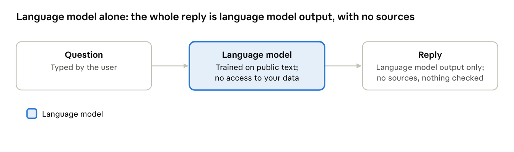
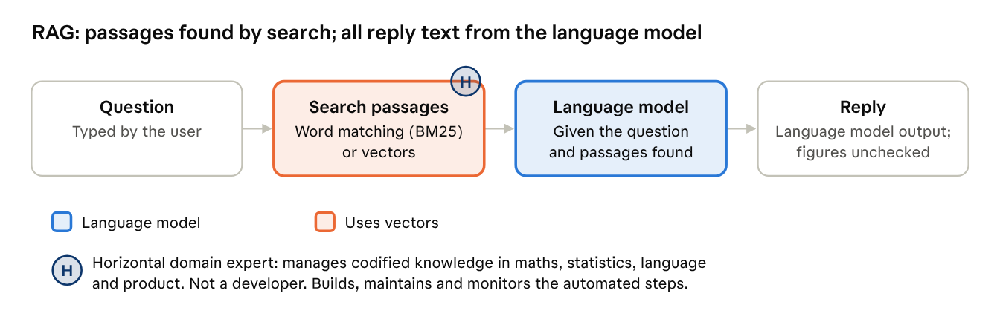
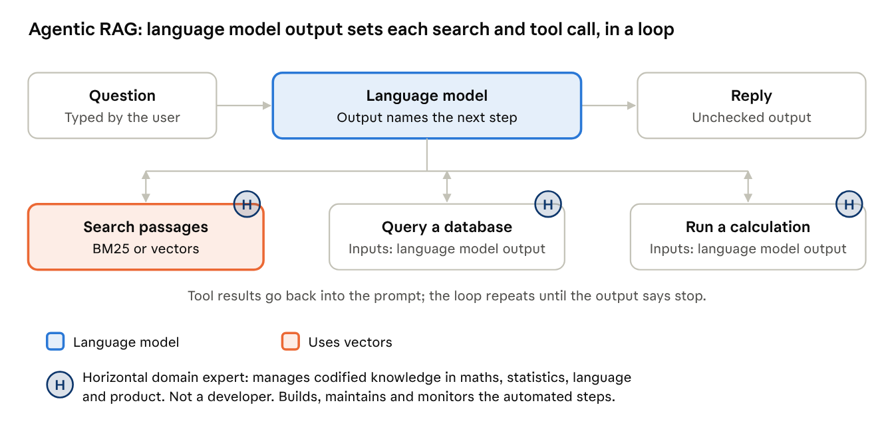
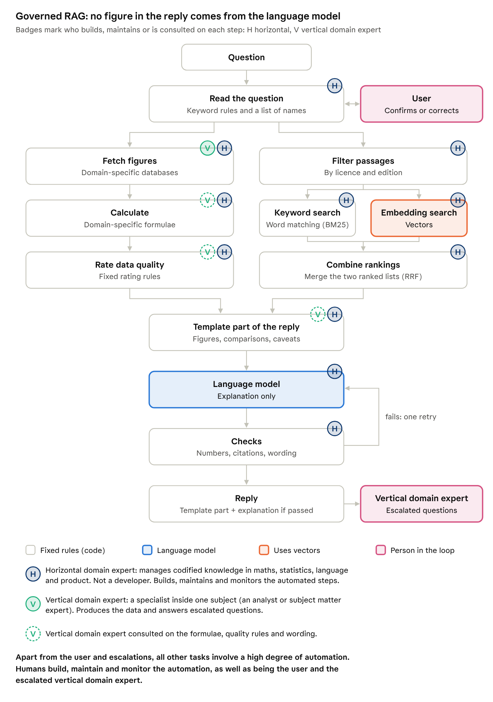

# Python RAG

## About this book

This book teaches retrieval-augmented generation (RAG) in Python by building one small working system, step by step. RAG means finding the right passages in your own documents first, then asking a language model to answer from those passages only.

**Reader.** Someone who knows the subject matter and reads code but is not a software developer. Code favours clear steps over speed.

**Running example.** Every chapter uses the same material:

- a corpus of 40 to 60 short passages on GDP statistics, quoted from published manuals and statistical offices, each with its paragraph reference;
- a bank of test questions, each with the passages that should answer it;
- a Python model that splits growth in real net national income per head into five parts (the NNI decomposition), used from Chapter 13.

The same corpus, questions and model drive the online demonstration *Demonstrating AI readiness: what it takes*.

**What this book is not.** The code is not production software. It runs on an ordinary laptop with free, open-source tools: Python, Ollama with the Qwen3 model, sentence-transformers, bm25s, Chroma and pytest. Nothing is sent to a paid or cloud service.

## Governed RAG

**RAG (retrieval-augmented generation):** a search finds passages that match the question, and they are sent to a language model with the question. The answer is the language model's output, numbers included, and nothing checks it against the data.

**Governed RAG**, the system this book builds: the passages are chosen and every figure is calculated with fixed rules before the language model is called. The reply starts with a template part, fixed templates filled with those figures and passages. The language model's output is used only for a short explanation, which is checked against the figures and passages; if it fails the checks twice, the reply is sent without it.

The language model is called between two sets of Python steps:

| Before the language model (code) | The language model | After the language model (code) |
| --- | --- | --- |
| Finds and filters passages (Chapters 3 to 10); routes the question (12); calculates the figures with the NNI model and fills the template part (13, 14) | Its output: an answer from the passages, or an explanation of the template part (11, 14) | Checks every sentence and drops an explanation that fails (14); counts tokens and lists every failure for review (15) |

### Four ways to answer a question

With a language model alone, the reply has no sources, so nothing in it can be traced or checked.

RAG adds a search, so the reply can cite passages. Every figure in it is still text from the language model.

In agentic RAG, the language model's output sets which search or tool to call next, and when to stop. A tool can return a correct figure, but the reply that quotes it is still unchecked text from the language model.

In Governed RAG, figures are fetched and calculated with fixed rules before the language model is called. Its output is used only for an explanation, which is checked; vectors are used in one step, the embedding search.

### Every figure has its lineage

Data lineage is the recorded history of a figure: where it came from, every change made to it, and what used it ([DAMA UK](https://www.linkedin.com/pulse/data-lineage-tracing-path-trusted-dama-uk-ltd-krxwe/)). In Governed RAG, every figure in the template part of the reply comes with its lineage: series code, source, edition and data quality rating.

The book records two kinds. Technical lineage is the trace: one line for each step of each question, with its output, seconds and tokens (Chapter 15); business lineage links the figure to what it means: the definition line, its passages and the glossary.

One role and one practice keep the lineage useful. A data steward is the person accountable for a definition, here the vertical domain expert; data observability is the ongoing monitoring of the system, done here by the horizontal domain expert with the checks, the review list, routing accuracy and token cost.

This matters outside economics. Banks must show how each reported figure was derived (BCBS 239), and the EU AI Act sets data governance rules for high-risk AI systems (Article 10).

## Who does what

Human work is listed here task by task, not by job title. A job is a bundle of tasks; taken apart, each task goes to code, the language model or one named person.

Apart from the user and escalations, all other tasks involve a high degree of automation. Humans build, maintain and monitor the automation, as well as being the user and the escalated vertical domain expert.

### Answering one question

| Task | Done by |
| --- | --- |
| Ask the question | User |
| Choose the use mode and the reply length | User |
| Read the economies, years and measures in the question | Code |
| Confirm or correct that reading | User |
| Route the question | Code |
| Ask the user to clarify a vague question | Code |
| Escalate a question beyond the data | Code |
| Keep only the passages the use mode allows | Code |
| Find the passages that match the question | Code |
| Calculate the figures | Code |
| Fill the template part | Code |
| Answer a definition question from passages | Language model |
| Explain the figures | Language model |
| Check each sentence of the explanation | Code |
| Retry once, or drop the explanation | Code |
| Record each step in the trace | Code |
| Answer an escalated question | Vertical domain expert |

### Building, maintaining and monitoring the system

| Task | Done by |
| --- | --- |
| Produce and publish the data | Vertical domain expert |
| Say what a measure means | Vertical domain expert |
| Find candidate passages in published manuals | AI coding assistant |
| Choose the passages for the corpus | Vertical domain expert |
| Check each passage's licence and format | Horizontal domain expert |
| Write the formulae | Horizontal domain expert |
| Agree the formulae | Vertical domain expert |
| Write the quality rules, checks and size bands | Horizontal domain expert |
| Agree the quality rules and size bands | Vertical domain expert |
| Write the routing rules, prompts and templates | Horizontal domain expert |
| Agree the wording of the templates | Vertical domain expert |
| Write and test the code | AI coding assistant |
| Direct and review the code | Horizontal domain expert |
| Write the questions in the question bank | Horizontal domain expert |
| Write the fair-test questions | Vertical domain expert |
| Judge whether a cited sentence is supported | Vertical domain expert |
| Score routing, retrieval and checks | Horizontal domain expert |
| Label each score training or fair | Horizontal domain expert |
| Read the review list | Horizontal domain expert |
| Change the rules after a review | Horizontal domain expert |
| Monitor routing accuracy and token cost | Horizontal domain expert |

Chapter 15 counts the language model's cost in tokens and seconds. The time people spend on these tasks is not counted.

## Lessons for a production version

The same list closes Chapter 15 (15.7).

### What worked

1. Every figure is calculated by Python from WDI and PWT data. The JavaScript version gives the same numbers for all 147 economy-years tested.
2. The template part gave an answer to all 24 questions in the Chapter 14 run and corrected q4-02's false premise.
3. The four kinds of mistake in the language model's output in Chapter 13 (wrong sign, false premise, added flags, escalation not called for; F15 to F18) cannot occur in the template part: each of those lines comes from a tested function.
4. The checks dropped all 28 faulty explanations and showed none.
5. The vertical domain expert judged 19 of 20 cited sentences supported; the word-overlap check agreed on 17.
6. Routing: 56 of 56 bank questions (training); 19 of 32 new questions in the first fair test.
7. Definition questions: a correct passage in the top three for 31 of 32.
8. The licence filter in the vector database kept the same passages as the hand-written filter on all 32 questions.
9. Every score is labelled training or fair; fair tests were frozen in a commit before the questions were opened.
10. After the review, two explanations with content passed (f-07, f-08), training scores.
11. Only the steps that call the language model use tokens: the explanation and, for definition questions, the answer extracted from passages. Lookups, series titles, clarifying and escalation are answered by code at no cost in tokens, and the steps in Python took under a tenth of a second for 24 questions.

### What a production version needs

1. A better reader for typed questions. Keyword rules gave the right figures for 2 of 20 new questions, the small language model for 9 of 20, and the routing rules sent 6 of the vertical domain expert's 10 questions to a route other than the labelled one: five because the rules did not know names such as USA and Japanese, one because a year of revision was read as a year of data. The demonstrator matches questions against a catalogue of measures in the knowledge graph (decision 25), which a production team keeps instead of a bank of questions.
2. A larger language model, with sentence and id requested as separate fields.
3. Counts of both kinds of check error: good replies dropped and bad replies shown.
4. A check that a reply is an answer to the question (f-09).
5. A named horizontal domain expert who sets and reviews the size bands, consulting the vertical domain expert.
6. New questions from real users, scored before any rule changes.
7. More data and passages (a passage defining PPP; the production boundary for unpaid work at home).
8. Explanations and their cited passages in a form the vertical domain expert can review quickly.
9. The review list in a form the horizontal domain expert can read quickly.
10. A token and time limit for each route. On the laptop, an R2 question with an explanation took about 3,100 tokens in and 108 seconds; a retry added about 1,800 tokens and 29 seconds, and gave real content only once out of 13 retries.

    Cost per route times the number of questions asked gives the total, so a team can price a rise in use.

## Chapter template

Every chapter has the same shape, so the reader always knows where they are.

1. **N.1 What this chapter builds** — one paragraph: what the reader will have at the end, the code file it produces, and the earlier chapters it uses.
2. **N.2, N.3 … one section per idea**, each in three parts:
    1. **Principles** — the idea in plain words, with any formula, before any code.
    2. **Code** — the file name and function name above a code block copied from the tested file.
    3. **Annotations** — what each step does and why; every new term explained.
3. **Tests for this chapter** — the checks that run on every change, and what each one proves.
4. **Glossary additions** and **Links**.

**Numbering.** Sections are numbered chapter.section.part, for example 3.2.1. Cross-references use those numbers: "see 4.3.2".

**Code files.** One file per chapter, named by chapter: `ch03_keyword_search.py`.

**Code reuse runs forward only.** A chapter's file may import functions from earlier chapters, never from later ones. Chapter 5 may use Chapter 3's `bm25_rank`; Chapter 3 never uses anything from Chapter 5. A test in the repository checks every import and fails if the rule is broken, so the book can be read in order without meeting unexplained code.

**Code style.** Plain loops rather than compressed one-line expressions; full variable names; one step per line; Python's standard library first; intermediate results printed so the reader can see each step.

## Contents

Fifteen chapters in four parts, then three appendices.

| Ch. | Title | Part | Code file | Uses chapters |
| --- | --- | --- | --- | --- |
| 1 | [The Python you need](ch01_python_basics.md) | Foundations | `ch01_python_basics.py` | — |
| 2 | [A minimal RAG pipeline in five functions](ch02_minimal_pipeline.md) | Foundations | `ch02_minimal_pipeline.py` | 1 |
| 3 | [Keyword search: word counts, TF-IDF and BM25](ch03_keyword_search.md) | Finding passages | `ch03_keyword_search.py` | 1, 2 |
| 4 | [Embeddings and semantic search](ch04_semantic_search.md) | Finding passages | `ch04_semantic_search.py` | 1–3 |
| 5 | [Hybrid search and the knowledge graph](ch05_hybrid_search.md) | Finding passages | `ch05_hybrid_search.py` | 3, 4 |
| 6 | [Chunking](ch06_chunking.md) | Finding passages | `ch06_chunking.py` | 1–5 |
| 7 | [Vector databases](ch07_vector_store.md) | Finding passages | `ch07_vector_store.py` | 4, 6 |
| 8 | [Filters, metadata and access rules](ch08_filters.md) | Finding passages | `ch08_filters.py` | 5, 7 |
| 9 | [Reranking](ch09_reranking.md) | Finding passages | `ch09_reranking.py` | 5, 8 |
| 10 | [Is the retriever any good?](ch10_evaluation.md) | Measuring retrieval | `ch10_evaluation.py` | 3–9 |
| 11 | [Prompts, context and model settings](ch11_prompts.md) | Generating answers | `ch11_prompts.py` | 2–5, 8 |
| 12 | [Routing questions](ch12_routing.md) | Generating answers | `ch12_routing.py` | 10, 11 |
| 13 | [Calling a model instead of writing numbers](ch13_model_tool.md) | Generating answers | `ch13_model_tool.py` | 11, 12 |
| 14 | [Checking answers](ch14_answer_checks.md) | Generating answers | `ch14_answer_checks.py` | 10–13 |
| 15 | [Monitoring token cost](ch15_token_cost.md) | Generating answers | `ch15_token_cost.py` | 12–14 |
| A | Fine-tuning or retrieval? (not yet written) | Appendix | none (concept only) | — |
| B | The same pipeline on Weaviate (not yet written) | Appendix | `appB_weaviate.py` | 7–9 |
| C | Glossary (not yet in this folder) | Appendix | — | — |
